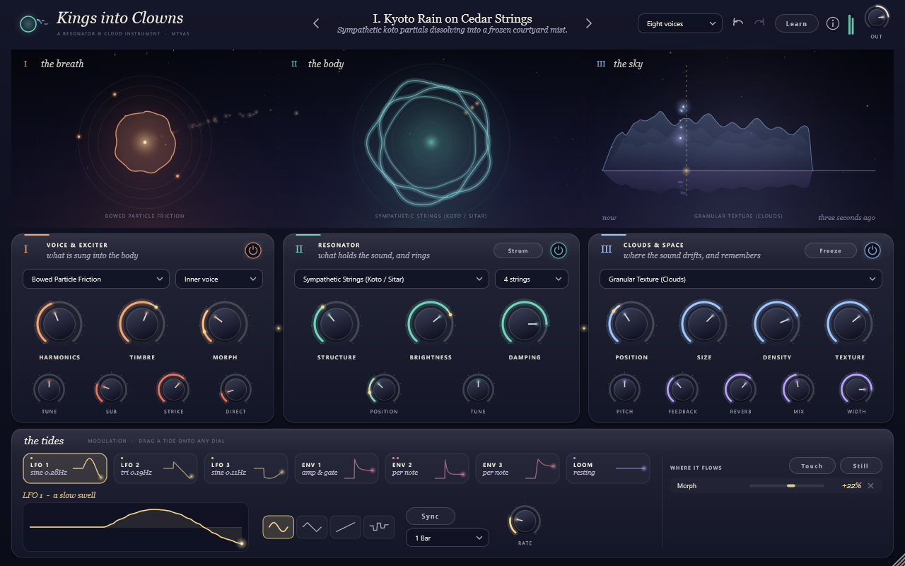
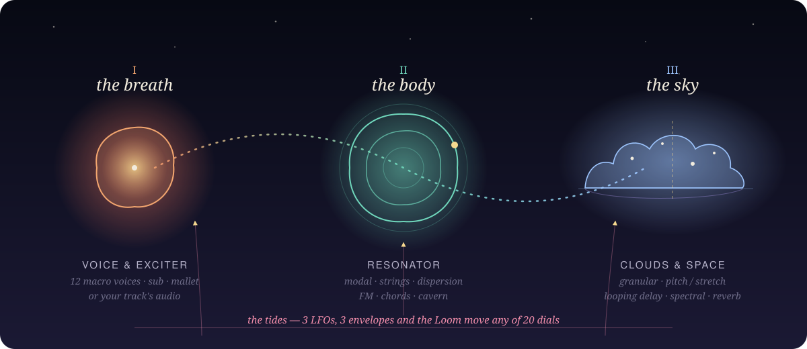
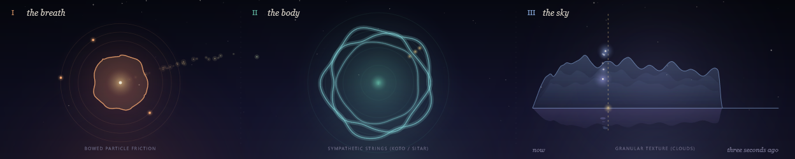
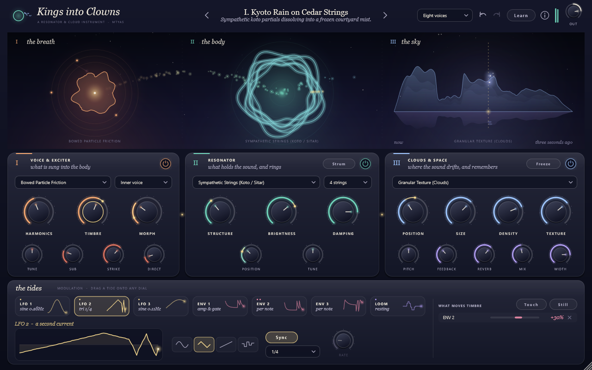
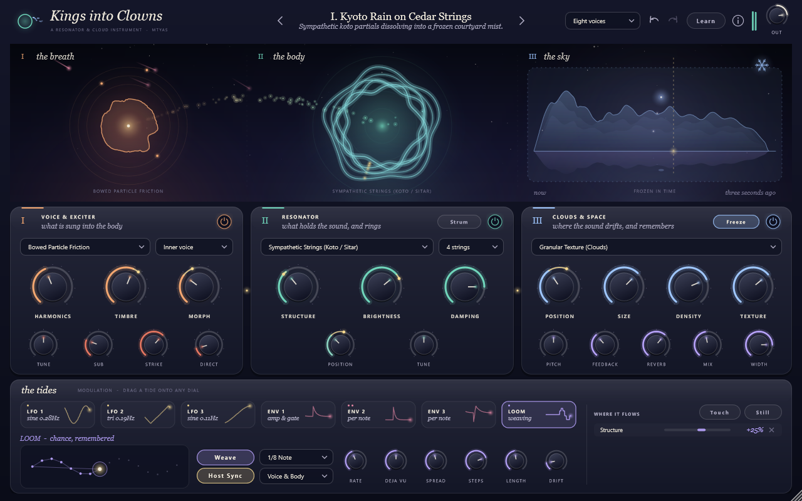
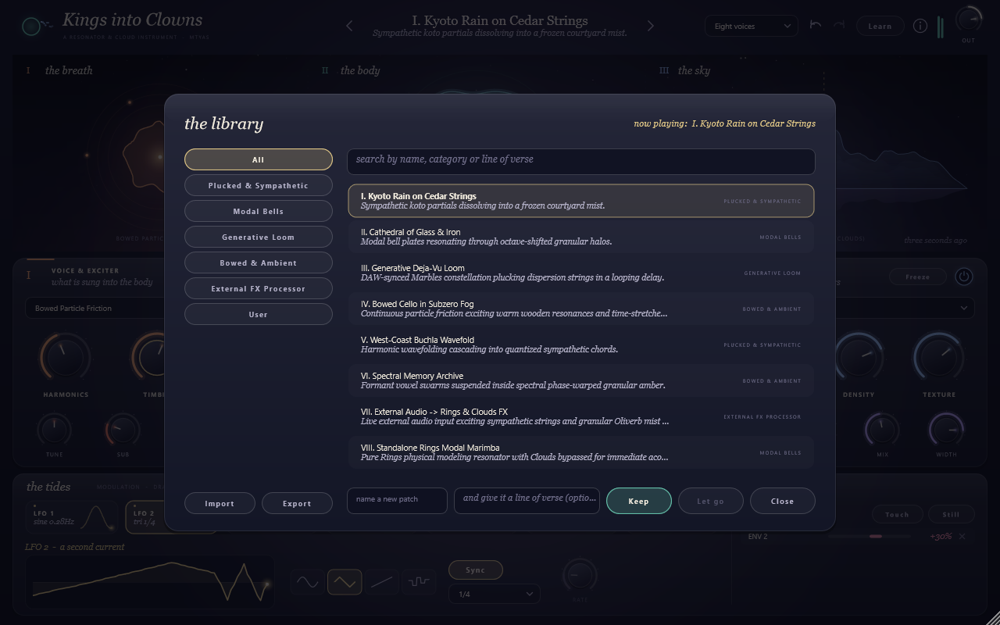
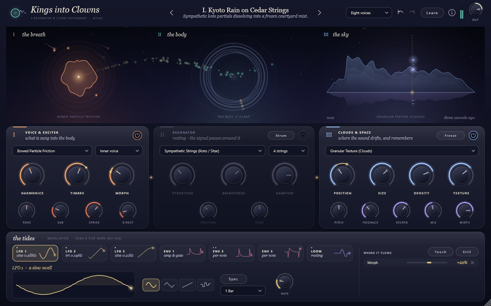

<h1 align="center"><i>Kings into Clowns</i></h1>

<p align="center"><i>a breath, a body, and the sky it dissolves into</i></p>

<p align="center">
  
</p>

**Kings into Clowns** is a resonator-and-cloud instrument for your DAW (VST3, CLAP, Standalone),
by [mtyas](https://mtyas.com). A macro-oscillator *breathes* into a physically modelled *body*
(strings, bells, glass), and whatever rings drifts up into a granular *sky* that remembers the
last few seconds of sound. Three LFOs, three envelopes and a generative *Loom* — the *tides* —
can move almost every dial.

It can also be an effect: feed your track's audio in and let it excite the resonator and the clouds.

<p align="center">
  
</p>

## What it does

- **I · the breath** — 12 macro voices (virtual analog, wavefolder, FM, formant, additive,
  wavetable, string ensemble, swarm, noise, bowed friction, Karplus-Strong pluck, mallet),
  a sub layer, a mallet strike, or your track's audio as the exciter.
- **II · the body** — 6 resonator models: modal bells & plates, sympathetic strings,
  inharmonic dispersion strings, FM, quantized sympathetic chords, and strings in a cavern reverb.
  Up to 4 strings per voice, 1–16 voices.
- **III · the sky** — 4 cloud modes: granular texture, pitch shifter / time stretch,
  looping delay, spectral warp — with freeze, feedback, width and a diffuse reverb.
- **The tides** — 3 LFOs (free or locked to the host tempo), 3 ADSR envelopes, and the
  **Loom**, a generative sequencer with *déjà vu* memory that can play melodies into the voice,
  the body, both, or only keep its rhythm.
- **Live everything** — a large animated canvas drawn from the audio itself, modulation you can
  *see* orbiting each dial, drag-and-drop modulation, a routing list that works both ways
  (*where does this tide flow?* / *what moves this dial?*).
- **Play it from the screen** — click the ember to breathe a note, click the rings to strum,
  drag across the sky to travel through time.
- **CLAP extras** — per-note polyphonic modulation and note expressions (tuning, brightness,
  pressure); MPE pitch bend and pressure over MIDI.
- **Patches with poems** — every patch carries a line of verse; a searchable library,
  import / export, MIDI learn, undo / redo, resizable window.

<p align="center">
  
</p>

## Read the manual

**[→ The manual](docs/MANUAL.md)** walks through every stage, dial and gesture.

<table>
<tr>
<td></td>
<td></td>
</tr>
<tr>
<td align="center"><i>touch a dial to see the tides that move it</i></td>
<td align="center"><i>the Loom weaving under a frozen sky</i></td>
</tr>
<tr>
<td></td>
<td></td>
</tr>
<tr>
<td align="center"><i>the library</i></td>
<td align="center"><i>a stage at rest — the signal passes around it</i></td>
</tr>
</table>

## Building

You need CMake ≥ 3.22 and a C++20 compiler (Visual Studio 2022+ on Windows, Xcode on macOS,
GCC/Clang on Linux). Dependencies — [JUCE 8.0.6](https://github.com/juce-framework/JUCE) and
[clap-juce-extensions](https://github.com/free-audio/clap-juce-extensions) — are downloaded
automatically, or taken from `deps/JUCE` and `deps/clap-juce-extensions` if you put them there.

```bash
git clone https://github.com/mtyas/Kings-into-Clowns.git
cd Kings-into-Clowns
cmake -S . -B build
cmake --build build --config Release
```

The plugins appear in `build/KingsIntoClowns_artefacts/Release/` (`CLAP/`, `VST3/`, `Standalone/`).
Copy the `.clap` to `C:\Program Files\Common Files\CLAP` (or `%LOCALAPPDATA%\Programs\Common\CLAP`)
and the `.vst3` to `C:\Program Files\Common Files\VST3`, then rescan in your DAW.

> **Windows:** clone into a short path (e.g. `C:\src\`) — JUCE's sources contain long file names
> that can exceed Windows' 260-character path limit when nested deeply.
>
> The default Windows build uses AVX2 (`/arch:AVX2`); remove it in `CMakeLists.txt` for older CPUs.

### Tests and tools

```bash
cmake --build build --config Release --target kings_into_clowns_test
build/Release/kings_into_clowns_test          # DSP verification suite
```

Optional developer tools (enable with `-DRIC_BUILD_UI_SNAPSHOT=ON` / `-DRIC_BUILD_HOST_SMOKE=ON`):
`ric_ui_snapshot` renders the interface off-screen to PNG (the images on this page come from it),
and `ric_host_smoke` hosts the built VST3 like a DAW to catch load and shutdown problems.

## Credits

Made by **Matthew Tyas (mtyas)** — [mtyas.com](https://mtyas.com) ·
[ko-fi.com/mtyas](https://ko-fi.com/mtyas).

The DSP is inspired by and adapted from the open-source Mutable Instruments Eurorack modules
(Braids, Plaits, Rings, Clouds, Marbles) and the Oliverb firmware by Émilie Gillet, released under
the MIT license. Kings into Clowns is an independent work and is not affiliated with or endorsed by
Mutable Instruments. See [THIRD_PARTY_NOTICES.md](THIRD_PARTY_NOTICES.md).
