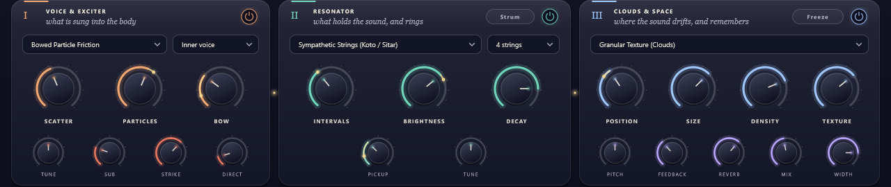
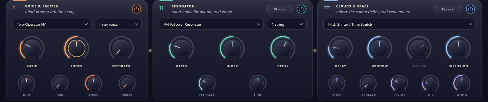
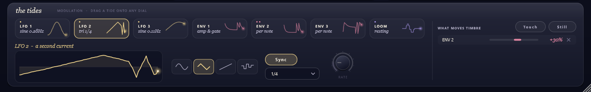
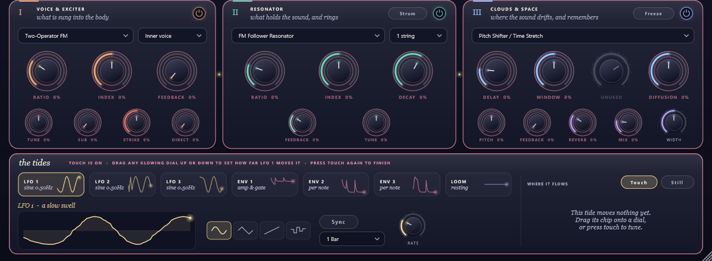
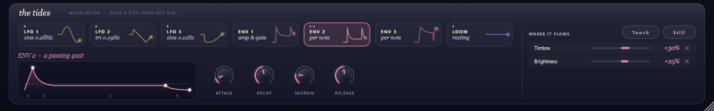
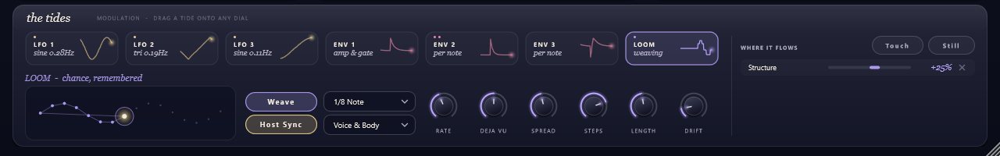
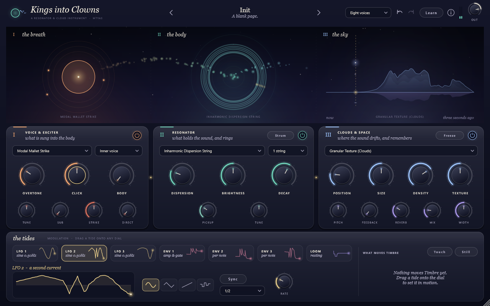

# Kings into Clowns — the manual

*a breath, a body, and the sky it dissolves into*

1. [The idea](#the-idea)
2. [A first ten minutes](#a-first-ten-minutes)
3. [The header](#the-header)
4. [The journey canvas](#the-journey-canvas)
5. [I · the breath — voice & exciter](#i--the-breath--voice--exciter)
6. [II · the body — resonator](#ii--the-body--resonator)
7. [III · the sky — clouds & space](#iii--the-sky--clouds--space)
8. [The tides — modulation](#the-tides--modulation)
9. [The Loom](#the-loom)
10. [Dials, gestures and menus](#dials-gestures-and-menus)
11. [The library — patches](#the-library--patches)
12. [MIDI, MPE and CLAP](#midi-mpe-and-clap)
13. [Using it as an effect](#using-it-as-an-effect)
14. [Recipes](#recipes)
15. [Troubleshooting](#troubleshooting)

---

## The idea

Sound travels from left to right, through three stages:

| | Stage | What it is |
|---|---|---|
| **I** | *the breath* | What is sung into the body: a macro oscillator (or your track's audio) plus a mallet strike. |
| **II** | *the body* | What holds the sound, and rings: a physically modelled resonator — strings, bells, glass, chords. |
| **III** | *the sky* | Where the sound drifts, and remembers: a granular cloud that records the last ~3 seconds, with reverb. |

Underneath, **the tides** — three LFOs, three envelopes and the generative **Loom** — can move any
of the twenty glowing dials of the three stages.

Each stage has a small **power ring** at its top right. Switch it off and the stage *rests*:
its dials grey out and the signal passes around it.

---

## A first ten minutes

1. Load the plugin on an instrument track and play a few notes. The first patch,
   *Kyoto Rain on Cedar Strings*, is a bowed exciter ringing sympathetic strings into a soft cloud.
2. Watch the canvas: the ember (I) trembles with the voice, a ring (II) appears for each note,
   and the cloud bank (III) grows from the left as the sky records what it hears.
3. Turn **Structure** in the body: harmonic strings become bells, glass, chords.
4. Turn **Position** in the sky — or simply **drag across the sky** on the canvas — to make the
   grains listen further back in time.
5. Press **Freeze**. The last seconds are held still; keep playing inside them.
6. Drag the **LFO 1** chip in the tides onto **Damping**. The dial starts to breathe; the gold
   "moon" on its rim shows where the modulation has taken it.
7. Click the ‹ › arrows next to the patch name to wander through the other patches.

---

## The header

| Control | What it does |
|---|---|
| **‹  patch name  ›** | Previous / next patch. Click the name (or its line of verse) to open **the library**. |
| **Voices** | *One voice* (monophonic, legato), *Four*, *Eight* or *Sixteen voices*. |
| **↶ ↷** | Undo / redo. Each gesture is one step. |
| **Learn** | MIDI learn: turn it on, touch a dial, move a controller. |
| **ⓘ** | About and credits. |
| **Output light & Out** | Output meter, and the final level (−24 to +6 dB). |

The window can be resized from its bottom-right corner (75 %–150 %); its size is remembered
with the session.

---

## The journey canvas

Everything on the canvas is drawn from the sound itself, about sixty times a second.

**I · the breath** — the ember is the voice's waveform, wrapped around itself. Three small
satellites orbit it: their positions are the live values of *Harmonics*, *Timbre* and *Morph*.
The caption names the current voice model.
*Click* the breath to sound a note (higher on the canvas = a higher octave).

**II · the body** — one ring per sounding voice. Low notes make wide rings, high notes small ones;
the ring trembles with the energy of the resonator, its number of lobes follows *Structure*, its
colour *Brightness*, and the golden spark marks the strike *Position*.
*Click* anywhere around the rings to strum: the angle chooses a pentatonic note, the distance from
the centre the strength.

**III · the sky** — the cloud bank is the sky's actual memory: *now* at the left, *three seconds
ago* at the right, dissolving as it ages, reflected in still water. The dashed golden line is the
**playhead** (*Position*); the small lights are the grains, placed by age, pitch (height) and
stereo position. A violet haze shows the reverb. When frozen, frost settles over it.
*Drag* across the sky: left/right sets **Position** (how far back the grains listen),
up/down sets grain **Size**.

Motes of light carry the sound from the breath through the body into the sky — the more energy,
the more motes. When the Loom plays, shooting stars cross the breath.

---

## I · the breath — voice & exciter

**The dials change their names with the model.** Harmonics, Timbre and Morph mean something
different in each voice model, and in each body and cloud mode, so the labels and tooltips under
the dials follow whatever is selected. A dial that does nothing in the current mode greys out and
reads *Unused*.

**Voice model** (left menu) — what the three large dials become:

| Model | Harmonics → | Timbre → | Morph → |
|---|---|---|---|
| Virtual Analog | **Detune** — second oscillator, up to a fifth | **Saw / Pulse** | **Pulse Width** |
| Buchla Wavefolder | **Sine / Tri** — the folded wave | **Fold** — drive into the folder | **Symmetry** |
| Two-Operator FM | **Ratio** of the modulator | **Index** — FM depth, grows with each strike | **Feedback** — clean in the centre |
| Vowel & Formant | **Formant 1** | **Formant 2** | **Narrowness** — round to buzzy |
| 24-Harmonic Additive | **Even / Odd** balance | **Centre** partial | **Focus** — narrows the spectrum |
| Wavetable Matrix | **Row** | **Column** | **Warp** — phase distortion |
| Solina String Ensemble | **Chord** — octave … phrygian | **Inversion** | **Waveform** — sine organ to saw strings |
| Formant Swarm Cloud | **Spread** of the swarm | **Formant** | **Noise** |
| Filtered Clocked Noise | **Clocked** — white to stepped | **Clock** — rate and filter | **Resonance** |
| Bowed Particle Friction | **Scatter** of particle pitch | **Particles** — density | **Bow** — steady bow and resonance |
| Karplus-Strong Pluck | **Burst** — noise that plucks | **Brightness** | **Sustain** |
| Modal Mallet Strike | **Overtone** — second partial | **Click** | **Body** — sustained body tone |

**Source** (right menu): *Inner voice* (the oscillator), *Outer audio* (your track's audio
excites the body — the voice dials grey out, see [Using it as an effect](#using-it-as-an-effect)),
or *Voice + audio*.

| Dial | What it does |
|---|---|
| **Tune** | Transposes the voice, ±24 semitones. |
| **Sub** | A lower, slightly crunchy shadow an octave beneath the voice. |
| **Strike** | How hard the internal mallet strikes the body on each note. |
| **Direct** | Lets some of the raw voice slip past the body, unresonated. |

The voice passes through a low-pass gate that follows **ENV 1**, like a vactrol.

> **Tip:** a voice tuned to the same note as the body (a saw or a bowed tone into a string)
> drives the body hard. Use *Strike*-like voices (Mallet, Karplus-Strong, Particles) for clean
> plucks, and lower *Out* for dense chords of sustained tones.

---

## II · the body — resonator

**Resonator model** (left menu) — what the dials become:

| Model | Structure → | Brightness → | Damping → | Position → |
|---|---|---|---|---|
| Modal Resonator — bars, plates, bells, glass | **Inharmonic** — harmonic to bell partials | **Brightness** | **Decay** | **Strike Point** |
| Sympathetic Strings — koto, sitar | **Intervals** — octaves, fifths, chords | **Brightness** | **Decay** | **Pickup** |
| Inharmonic Dispersion String | **Dispersion** — stiffness and detune; past the middle, pitch bends with energy | **Brightness** | **Decay** | **Pickup** |
| FM Follower Resonator | **Ratio** | **Index** | **Decay** — how long it follows the exciter | **Feedback** |
| Sympathetic Quantized Chords | **Chord** | **Brightness** | **Decay** | **Pickup** |
| String & Cavern Reverb | **Dispersion** | **Brightness** (and the cave's tone) | **Decay** (and the cave's size) | **Space** — pickup and how much cave |

**Strings** (right menu): 1, 2 or 4 strings inside each voice (the sympathetic models use 2, 3 or 4).
**Tune** tunes the body against the note played, ±24 semitones.
**Strum** plucks the body without a keyboard (as does clicking the rings on the canvas).

The "Damping" dial is shown as **Decay** because turning it up makes the body ring *longer*.

---

## III · the sky — clouds & space

**Cloud mode** — what happens, and what the dials become:

| Mode | Position → | Size → | Density → | Texture → | Pitch → | Feedback → |
|---|---|---|---|---|---|---|
| **Granular Texture** — grains from the last ~3 s | **Position** — how far back | **Size** — 15–650 ms grains | **Density** | **Texture** — grain edges, diffusion | **Pitch** | **Feedback** |
| **Pitch Shifter / Time Stretch** — two crossfading windows | **Delay** — 10 ms–1.2 s behind | **Window** — grainy to smooth | *Unused* | **Diffusion** | **Pitch** — transposition only | **Feedback** — rising/falling spirals |
| **Looping Tap Delay** — replays the latest segment | **Delay** — loop ends 10 ms–1.5 s ago | **Loop** — 40 ms–1.8 s | *Unused* | **Smoothness** — hard cuts to swells | **Speed** — tape-style | **Repeats** — crossing left/right |
| **Spectral Phase Warp** — granular, then resonant bands | **Position** (also shifts the bands) | **Size** (also odd/even band balance) | **Density** | **Resonance** of the bands | **Pitch** | **Feedback** |

**Density** (granular modes): sparse at the centre; turning left gives regular, clocked grains,
turning right dense and scattered ones.

| Dial | What it does |
|---|---|
| **Reverb** | The size of the space around it all. |
| **Mix** | From the bare body to the whole sky (equal-power). |
| **Width** | How wide the cloud spreads in stereo. |

**Freeze** stops the memory from recording: the last seconds are held, and the grains keep
playing inside them. In the looping delay, Freeze holds the loop itself.

---

## The tides — modulation

Seven sources, each shown as a chip with a live trace of what it is doing:

| Chip | Source | Range |
|---|---|---|
| **LFO 1–3** | low-frequency oscillators: sine, triangle, saw or *s&h* (smooth random) | bipolar |
| **ENV 1** | the amplitude envelope (it also opens the voice's low-pass gate) | 0 → 1 |
| **ENV 2, ENV 3** | free modulation envelopes, per note | 0 → 1 |
| **LOOM** | the generative sequencer's melody (see below) | bipolar |

The small dots on a chip count how many dials it moves.

### Connecting a tide to a dial

- **Drag** a chip onto any glowing dial (the dial's rim turns rose as you hover).
  It connects at +30 %.
- Or select a chip and press **Touch**: every dial this tide can reach glows and pulses in rose,
  the stages are framed in rose, and each dial shows its name with the current depth
  (*RATIO +30%*). Drag any dial up or down to set how far the tide moves it; double-click a dial to
  disconnect it. A rose banner reminds you Touch is on — press **Touch** again to finish.

- Or right-click a dial → **Tides** → choose a source and a depth.

Pitch dials (*Tune*, *Pitch*) are scaled so that 100 % = ±24 semitones.

### Where it flows / what moves it

The column on the right reads the modulation both ways:

- **Click a chip** → *WHERE IT FLOWS*: every dial that tide moves.
- **Click a dial** → *WHAT MOVES TIMBRE* (for example): every tide moving that dial. The inspected
  dial gets a golden rim.

In both views, **drag a row left/right** to change its depth, click **×** to let it go, and press
**Still** to disconnect everything listed.

### LFO pages

Select an LFO chip to see its recent output, its **shape** (four drawn buttons), its **Rate**
(0.02–20 Hz) and **Sync**.

With **Sync** on, the LFO follows the host tempo: choose one full cycle per *4 bars* down to
*1/32*, including dotted and triplet values. While the transport plays, the LFO is locked to the
bar — it starts in the same place every time you press play. *Rate* greys out while synced.

### Envelope pages

Shape an envelope by hand: drag the **peak** (attack time), the **shoulder** (decay time and
sustain level) and the **tail** (release time) — or use the four small dials. The golden dashed
line shows the envelope's live level.

---

## The Loom

The Loom is a generative sequencer in the spirit of *Marbles*. On each step it decides whether to
*strum* and which note to play, remembering its choices in a loop of up to 16 steps.
The constellation shows that loop: the lit dots are the steps in use, the bright star is the step
sounding now.

| Control | What it does |
|---|---|
| **Weave** | Starts and stops the Loom. |
| **Host Sync** + division | Steps follow the host tempo (1/1 bar … 1/32, dotted, triplets). Off: the free **Rate**. |
| **Melody to** | Where the Loom's melody goes: **Voice & Body**, **Voice only**, **Body only**, or **Rhythm only** (strums without changing pitch). |
| **Rate** | Free-running pace, 0.25–16 steps per second. |
| **Déjà Vu** | Left: always new. Centre: the loop repeats exactly. Right: the loop is replayed in shuffled order. |
| **Spread** | How far the melody wanders (a scale across up to ±16 semitones). |
| **Steps** | Below the middle: smooth glides. Above: stepped notes, quantized to the scale. |
| **Length** | How many steps the loop remembers (1–16). |
| **Drift** | How loosely the Loom keeps time. |

If notes are held, the Loom re-strums them (moving their pitch as *Melody to* allows). If nothing is
held, it plays its own short notes around middle C. Its melody is also a modulation source (the
**LOOM** chip), so it can move any dial too.

> Separating *Voice only* and *Body only* is a lovely trick: let the Loom wander the voice's pitch
> while the strings stay tuned to your chord — or keep the voice still and retune the body under it.

---

## Dials, gestures and menus

| Gesture | Effect |
|---|---|
| Drag up/down | Change the value. Hold **Shift** for velocity-sensitive dragging (move slowly for fine steps). |
| Double-click | Return to the default. |
| Mouse wheel | Nudge. |
| Hover | Shows the value in place of the label; the name returns as soon as the pointer leaves. |
| Click | Lists the tides moving this dial in the right-hand column. |
| Right-click | Menu: return to default, learn / forget a MIDI CC, connect any tide at ±10/25/50 %, still all tides on this dial. |
| Drop a tide | Connects that tide. |

On every modulated dial, the **gold moon** riding the rim shows where the modulation has taken the
value right now; the gold arc joins it to the dial's own setting.

---

## The library — patches

Open it by clicking the patch name. Categories on the left come from the patches themselves;
the search field finds words in names, categories *and* lines of verse.

- **Init** starts from a blank page: a plain mallet strike on one string, a light cloud, every
  tide disconnected. It is not in the patch list; ‹ › from Init go to the first / last patch.
- **Click** a patch to hear it, **double-click** (or press Enter) to choose it and close.

- **Keep** saves the current sound as a new patch — give it a name and, if you like, a line of verse.
- **Let go** deletes the selected patch (your own patches only).
- **Import / Export** share `.kicpreset` files (older `.ricpreset` files load too).

Your patches live in your user application-data folder under `mtyas/KingsIntoClowns/Presets`.
A patch stores every dial, every switch and every tide connection.

---

## MIDI, MPE and CLAP

- **MIDI learn**: press *Learn*, touch a dial, move a controller. Or right-click a dial →
  *Learn MIDI CC*. Learned CCs are shown under the dial's name and saved with the session.
- **CC 1 / CC 74** brighten the voice (timbre), **channel / poly aftertouch** brightens the body.
- **Pitch bend**: ±2 semitones on channel 1, ±12 on other channels (MPE).
- In **CLAP** hosts (Bitwig, REAPER, …) the twenty modulatable dials accept *polyphonic
  modulation* per note, and note expressions for tuning, brightness and pressure are supported.

---

## Using it as an effect

Set **Source** to *Outer audio* and put the plugin on an audio track (or route audio into its
input). With no notes held, the body listens on its own and rings at middle C; play MIDI notes to
retune it to your melody or chord. *Voice + audio* mixes the inner voice in as well.
The breath's power ring can be switched off when you only want the audio.

The factory patch *VII. External Audio -> Rings & Clouds FX* is a good starting point.

---

## Recipes

- **Glass rain** — Modal Resonator, *Structure* ~0.7, *Damping* high, *Modal Mallet Strike* voice;
  Loom on, *Melody to: Body only*, *Steps* high; sky in Granular with *Position* far back.
- **Frozen cathedral** — play a chord, press **Freeze**, then drag slowly across the sky.
- **Breathing strings** — Bowed Particle Friction into Sympathetic Strings;
  drag **ENV 2** onto *Brightness* and **LFO 1** (synced, 2 bars, triangle) onto *Position*.
- **Rhythmic dust** — Filtered Clocked Noise into the Looping Tap Delay, Loom synced to 1/16,
  *Melody to: Rhythm only*.

---

## Troubleshooting

- **No sound**: check that at least one path is on (breath *or* Outer audio, and the body or the
  sky), *Mix* isn't fully dry with the body resting, and *Out* isn't at −24 dB.
- **The LFO doesn't start at the bar**: *Sync* locks to the bar only while the host transport plays;
  when stopped it simply runs at the tempo.
- **The Loom does nothing**: press *Weave*. With *Host Sync* on, the host must report a tempo.
- **High CPU**: lower *Voices*, use fewer strings, or prefer the string models over the modal one
  at high polyphony. The animated canvas costs a few milliseconds per frame on the UI thread only.
